# ERD do Incident FastTrack

Modelo da secção 8.1 do documento de 12 de novembro de 2026. Inclui as 18 tabelas, os 110 campos e as 32 referências por chave estrangeira. Os campos seguem a ordem do documento.

- `PK` identifica a chave primária, `FK` a chave estrangeira e `UK` uma chave única. Em `OwnerIncidentTypes`, as duas colunas assinaladas formam uma única chave primária composta.
- Os marcadores `id`, `text` e `campo` são rótulos de apresentação. A secção 8.1 enumera campos e chaves sem especificar os tipos SQL para todos os campos. A introdução do ponto 8 especifica `NVARCHAR(MAX)` para campos de estrutura JSON como `AssignmentLog.CandidatesJson`.
- `NULL` identifica as FKs explicitamente descritas como opcionais. Para as restantes FKs, o diagrama assume que são obrigatórias. Do lado inverso, cada registo principal pode ter zero ou muitos dependentes.
- As linhas contínuas representam relações identificadoras, em que a FK integra a PK. As linhas tracejadas representam as restantes relações.

```mermaid
erDiagram
    direction LR
    Companies {
        id CompanyId PK
        campo CompanyName
    }
    Roles {
        id RoleId PK
        campo RoleName
    }
    Users {
        id UserId PK
        campo Name
        text Email UK
        campo PasswordHash
        id RoleId FK
        id CompanyId FK
        campo IsActive
        campo EmailVerified
        campo IsAvailable
        campo MaxOpenIncidents
        campo LastAssignedAt
        campo CreatedAt
        campo LastLoginAt
        campo IsDeleted
        campo DeletedAt
    }
    Priorities {
        id PriorityId PK
        campo PriorityName
    }
    IncidentTypes {
        id IncidentTypeId PK
        campo TypeName
    }
    IncidentStatuses {
        id StatusId PK
        campo StatusName
    }
    ExternalParties {
        id PartyId PK
        campo PartyType
        campo Name
    }
    Incidents {
        id IncidentId PK
        campo ReferenceNumber
        campo Title
        campo Description
        id IncidentTypeId FK
        id PriorityId FK
        id StatusId FK
        id CompanyId FK
        campo Location
        campo OccurredAt
        campo CreatedAt
        campo UpdatedAt
        id ReportedByUserId FK
        id AssignedToUserId FK "NULL"
        campo AcceptedAt
        campo ClosedAt
        campo RejectionReason
        campo Resolution
        id DuplicateOfIncidentId FK "NULL"
        campo IsDeleted
        campo DeletedAt
    }
    IncidentStatusHistory {
        id HistoryId PK
        id IncidentId FK
        id PreviousStatusId FK "NULL"
        id NewStatusId FK
        id PreviousAssigneeId FK "NULL"
        id NewAssigneeId FK "NULL"
        id ChangedByUserId FK
        campo ChangedAt
        campo Comment
    }
    IncidentComments {
        id CommentId PK
        id IncidentId FK
        id UserId FK
        campo Text
        campo IsInternal
        campo CreatedAt
    }
    Attachments {
        id AttachmentId PK
        id IncidentId FK
        id UploadedByUserId FK
        campo FileName
        campo StoragePath
        campo ContentType
        campo SizeBytes
        campo CreatedAt
    }
    IncidentExternalRequests {
        id RequestId PK
        id IncidentId FK
        id PartyId FK
        campo SentAt
        campo ResponseAt
        campo Outcome
        campo Notes
    }
    PasswordResetTokens {
        id TokenId PK
        id UserId FK
        campo TokenHash
        campo ExpiresAt
        campo UsedAt
    }
    OwnerIncidentTypes {
        id UserId PK, FK
        id IncidentTypeId PK, FK
    }
    AssignmentRules {
        id RuleId PK
        id CompanyId FK "NULL"
        id IncidentTypeId FK "NULL"
        campo Strategy
    }
    AssignmentLog {
        id LogId PK
        id IncidentId FK
        id ChosenOwnerId FK
        campo Strategy
        campo CandidatesJson
        campo CreatedAt
    }
    DuplicateChecks {
        id CheckId PK
        id IncidentId FK
        id MatchedIncidentId FK
        campo Score
        campo UserDecision
    }
    Notifications {
        id NotificationId PK
        id UserId FK
        id IncidentId FK "NULL"
        campo Type
        campo Channel
        campo Message
        campo SentAt
        campo ReadAt
        campo Status
    }
    Roles ||..o{ Users : RoleId
    Companies ||..o{ Users : CompanyId
    IncidentTypes ||..o{ Incidents : IncidentTypeId
    Priorities ||..o{ Incidents : PriorityId
    IncidentStatuses ||..o{ Incidents : StatusId
    Companies ||..o{ Incidents : CompanyId
    Users ||..o{ Incidents : ReportedByUserId
    Users o|..o{ Incidents : AssignedToUserId
    Incidents o|..o{ Incidents : DuplicateOfIncidentId
    Incidents ||..o{ IncidentStatusHistory : IncidentId
    IncidentStatuses o|..o{ IncidentStatusHistory : PreviousStatusId
    IncidentStatuses ||..o{ IncidentStatusHistory : NewStatusId
    Users o|..o{ IncidentStatusHistory : PreviousAssigneeId
    Users o|..o{ IncidentStatusHistory : NewAssigneeId
    Users ||..o{ IncidentStatusHistory : ChangedByUserId
    Incidents ||..o{ IncidentComments : IncidentId
    Users ||..o{ IncidentComments : UserId
    Incidents ||..o{ Attachments : IncidentId
    Users ||..o{ Attachments : UploadedByUserId
    Incidents ||..o{ IncidentExternalRequests : IncidentId
    ExternalParties ||..o{ IncidentExternalRequests : PartyId
    Users ||..o{ PasswordResetTokens : UserId
    Users ||--o{ OwnerIncidentTypes : UserId
    IncidentTypes ||--o{ OwnerIncidentTypes : IncidentTypeId
    Companies o|..o{ AssignmentRules : CompanyId
    IncidentTypes o|..o{ AssignmentRules : IncidentTypeId
    Incidents ||..o{ AssignmentLog : IncidentId
    Users ||..o{ AssignmentLog : ChosenOwnerId
    Incidents ||..o{ DuplicateChecks : IncidentId
    Incidents ||..o{ DuplicateChecks : MatchedIncidentId
    Users ||..o{ Notifications : UserId
    Incidents o|..o{ Notifications : IncidentId
```

## Campos por tabela

| Tabela | Campos |
| --- | ---: |
| `Companies` | 2 |
| `Roles` | 2 |
| `Users` | 15 |
| `Priorities` | 2 |
| `IncidentTypes` | 2 |
| `IncidentStatuses` | 2 |
| `ExternalParties` | 3 |
| `Incidents` | 21 |
| `IncidentStatusHistory` | 9 |
| `IncidentComments` | 6 |
| `Attachments` | 8 |
| `IncidentExternalRequests` | 7 |
| `PasswordResetTokens` | 5 |
| `OwnerIncidentTypes` | 2 |
| `AssignmentRules` | 4 |
| `AssignmentLog` | 6 |
| `DuplicateChecks` | 5 |
| `Notifications` | 9 |
| **Total** | **110** |

O documento indica ainda os valores iniciais `User`, `Owner` e `Admin` para `Roles` e `Submitted`, `Triage`, `Rejected`, `Accepted`, `In Progress`, `Pending External`, `Resolved` e `Closed` para `IncidentStatuses`. Estes são os valores descritos no DOCX.

