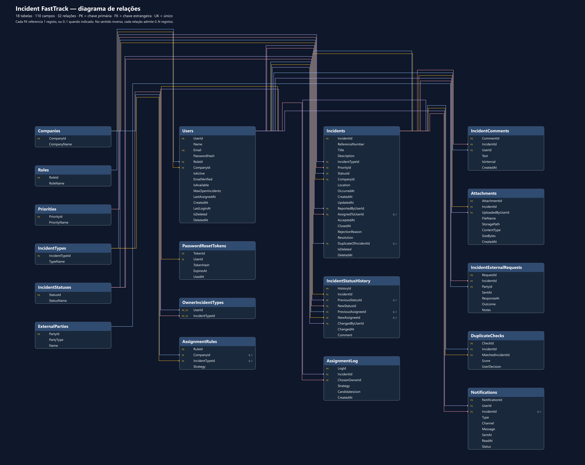

# Incident FastTrack

Aplicação web para reportar, acompanhar e resolver incidentes, com separação de dados por empresa. Centraliza a triagem, os responsáveis, o histórico e os pedidos de informação a entidades externas, como seguradoras, RH e faturação.

> Este README descreve a proposta do documento de design de 12 de novembro de 2026. As funcionalidades apresentadas fazem parte do âmbito previsto.

## Perfis de acesso

| Perfil | Responsabilidades |
| --- | --- |
| **User** | Reportar incidentes, acompanhar os seus pedidos, comentar e exportar os seus incidentes. |
| **Owner** | Analisar os incidentes atribuídos, aceitar ou rejeitar com motivo, tratar da resolução e gerir pedidos externos. |
| **Admin** | Gerir utilizadores, empresas e configurações, acompanhar a fila de incidentes e intervir na atribuição. |

As permissões são verificadas no servidor. A associação à empresa e o perfil determinam o acesso aos dados.

## Como funciona

1. O **User reporta um incidente** e recebe um aviso se forem encontrados possíveis duplicados.
2. O sistema **atribui um Owner elegível da mesma empresa**. Se não existir, o incidente aguarda na fila e o Admin é alertado. #TBD
3. O **Owner faz a triagem**, aceitando o incidente ou rejeitando-o com uma justificação.
4. O Owner trabalha na resolução e pode solicitar informação a entidades externas.
5. O incidente é **resolvido e fechado**, após a conclusão dos pedidos externos em aberto.

O ciclo previsto passa por `Submitted → Triage → Accepted → In Progress → Resolved → Closed`. A triagem também pode terminar em `Rejected`, e o tratamento pode passar por `Pending External`.

## Funcionalidades previstas

- **Gestão de incidentes** com prioridade, tipo, estado e responsável.
- **Comentários, anexos e histórico** das ações sobre cada incidente.
- **Atribuição por regras**, considerando empresa, disponibilidade, especialização e carga de trabalho.
- **Deteção de possíveis duplicados** antes da submissão.
- **Pedidos externos** para apoiar a resolução.
- **Notificações na aplicação e por email**, com envio assíncrono.
- **Exportação em PDF** dos dados autorizados do incidente.
- **Eliminação lógica** de utilizadores e incidentes através de `IsDeleted` e `DeletedAt`.

## Modelo de dados

A base de dados prevista é **Microsoft SQL Server**. O modelo contém **18 tabelas, 110 campos e 32 chaves estrangeiras**.

### Relações principais

| Entidades | Relação |
| --- | --- |
| `Companies → Users / Incidents` | Uma empresa pode ter vários utilizadores e incidentes. Cada utilizador e incidente pertence a uma empresa no modelo do Word. |
| `Roles → Users` | Cada utilizador tem um perfil. O mesmo perfil pode ser usado por vários utilizadores. |
| `Users → Incidents` | Cada incidente tem um autor e pode ter um Owner atribuído. Um utilizador pode estar associado a vários incidentes. |
| `Priorities / IncidentTypes / IncidentStatuses → Incidents` | Cada incidente tem uma prioridade, um tipo e um estado atual. |
| `Incidents → IncidentStatusHistory / IncidentComments / Attachments` | Um incidente pode reunir vários registos de histórico, comentários e anexos. |
| `Incidents ↔ ExternalParties` | Vários incidentes podem envolver várias entidades externas, através de `IncidentExternalRequests`. |
| `Users ↔ IncidentTypes` | `OwnerIncidentTypes` associa os Owners aos tipos de incidente que podem tratar. |
| `Incidents → Incidents` | `DuplicateOfIncidentId` permite ligar um duplicado ao incidente original. A ligação é opcional. |

As restantes tabelas apoiam o funcionamento da aplicação.

- `AssignmentRules` e `AssignmentLog` guardam as regras e as decisões de atribuição.
- `DuplicateChecks` guarda os candidatos avaliados, a pontuação e a decisão do utilizador.
- `Notifications` guarda as notificações de cada utilizador.
- `PasswordResetTokens` guarda os dados necessários à recuperação de acesso.

**Legenda** — `PK` identifica uma chave primária, `FK` uma chave estrangeira e `UK` um valor único. Em `OwnerIncidentTypes`, os dois campos formam uma chave primária composta.

## Decisões por validar

O Word e o diagrama representam uma proposta com **User, Owner e Admin**, atribuição automática e oito estados. As decisões anteriores do projeto previam **User, Manager, Fixer e Admin técnico**, atribuição manual pelo Manager e quatro estados — **Pendente, Rejeitado, Atribuído e Resolvido**.

Esta escolha precisa de ser confirmada antes de implementar o fluxo e as permissões. O Word também precisa de esclarecer a rejeição, descrita como final no ciclo de vida e como motivo para nova atribuição na secção de regras.

## Documentação

- **Documento de referência** — `Incident-FastTrack-Design.docx`, de 12 de novembro de 2026.
- **Modelo completo** — [ERD em Mermaid](Incident-FastTrack-ERD.md).

